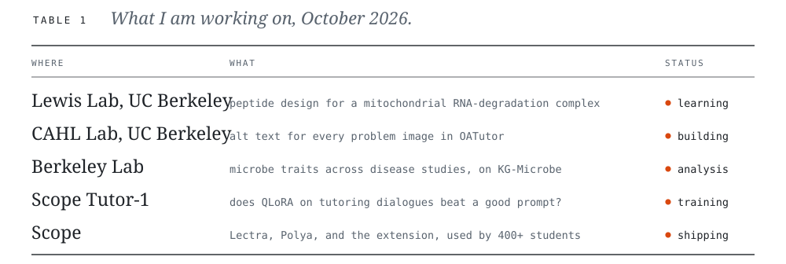

<!-- Figures are generated: edit assets/build.py, then run `python3 assets/build.py`. -->

<picture>
  <source media="(prefers-color-scheme: dark)" srcset="assets/header-dark.svg">
  <source media="(prefers-color-scheme: light)" srcset="assets/header-light.svg">
  
</picture>

I study molecular and cell biology and data science at UC Berkeley, and I'm interested in how you
check that a model can actually do what its score says it can. So far that has meant auditing a
benchmark, pre-registering a fine-tuning experiment, and building agents that verify their own
work. Longer term I want to work where AI and biology meet, on keeping models that are good at
biology from making it easier to misuse.

<picture>
  <source media="(prefers-color-scheme: dark)" srcset="assets/table-dark.svg">
  <source media="(prefers-color-scheme: light)" srcset="assets/table-light.svg">
  
</picture>

### Research

**Trial order, recording time, and checkpoint selection in a 39-way imagined-speech EEG benchmark**<br>
<sub>Noel Sason · 2026 · self-published, not peer reviewed · [paper](https://noelsason.com/papers/sason-2026-imagined-speech-eeg-audit.pdf) · [code](https://github.com/NoelSason/eegwords)</sub><br>
The published accuracy on this benchmark is 13.88%. Copying the label of the previous training
trial, with no EEG at all, scores 18.8%, because the trials run in category clusters and every test
trial sits inside a training run. With whole runs held out, real labels beat shuffled ones by 0.64
points, which is within seed noise. One participant.

<details>
<summary><sub>cite</sub></summary>

```bibtex
@misc{sason2026eeg,
  title  = {Trial order, recording time, and checkpoint selection
            in a 39-way imagined-speech {EEG} benchmark},
  author = {Sason, Noel},
  year   = {2026},
  note   = {Self-published, not peer reviewed},
  url    = {https://github.com/NoelSason/eegwords}
}
```

</details>

**Scope Tutor-1** &nbsp;<sub>post-training · in progress</sub><br>
Does QLoRA fine-tuning on tutoring dialogues make Qwen3-4B a better tutor than the same model with
a well-written prompt? The prompt it has to beat is frozen, no test problem appears in training,
and the endpoint was written down before any model was trained. Runs are going now on MLX, nothing
has been scored on the held-out problems, and the prompt may well win.

**Fabric** &nbsp;<sub>self-supervised vision · null result</sub><br>
A pre-registered test of an uncertainty-routing method across eight seeds. It found no supported
improvement from hierarchical targets under the tested protocol, so I closed the study with the
results and analysis written up. Synthetic data only, and no real-image result is claimed.

**Checking a model's alt text** &nbsp;<sub>CAHL Lab · [OATutor](https://github.com/CAHLR/OATutor)</sub><br>
Before the lab's GPT-4o alt-text generator ran on more courses, I tested it against the original
graphs. It misread coordinates, endpoints, and open versus closed points, so its output stayed out
of the course content. My project carries hand-written alt text for every problem image from the
spreadsheets authors write in through to the page a screen reader reads.

**KG-Microbe trait tables** &nbsp;<sub>Berkeley Lab · merged</sub><br>
The lab's pipeline connects published human-microbiome studies to a knowledge graph, so you can ask
what the microbes that shift in a disease have in common. I wrote the step that turns each study's
results into a trait table, 319 experiments across 127 traits, and it was reviewed and merged.

### Agents

**[Overclock](https://github.com/NoelSason/Overclock)** &nbsp;<sub>Cal Hacks 13.0</sub><br>
Browser agents usually ask a model what to do before every click. Overclock plans a task once,
compiles it into a program, and replays the program, reading the page back to confirm every change.
On the hackathon's mock apps, graded by its own checker, it reconciled 500 of 500 records in a warm
median of 13.8 s, and a second runtime that imported the first one's compiled workflow finished
without a planning call. It hasn't been tried on a site it has never seen, behind a login, or
against a published benchmark.

**Noel MCP** &nbsp;<sub>private</sub><br>
One server that every assistant I use connects to, so they all reach the same twenty-odd places I
work, from mail and repositories to the literature search and the cluster. Reading is free, and
anything that sends, publishes, or changes something waits until I approve that exact action.
Running my own tools through an approval queue has taught me more about letting an agent act safely
than reading about it did.

**[ios-agent-use](https://github.com/NoelSason/ios-agent-use)** &nbsp;<sub>open source · Claude Code plugin</sub><br>
Lets a coding agent open a real iOS app, tap through it, and read back what changed on screen.

### Scope

**[Scope](https://canvascope.org)** &nbsp;<sub>founder, sole developer · 400+ students at 20+ colleges · 58,000+ course items synced</sub><br>
Student software built around the courses students already have. The rule I build by is to
automate everything around learning without automating the learning itself.

- [Lectra](https://apps.apple.com/us/app/lectra-notes/id6759754531) is an iPad app for marking up
  PDFs with Apple Pencil, and it runs Python, git, and a shell on the device itself.
- [Polya](https://askpolya.com) tutors from your own course materials, gives hints instead of
  answers, and cites the page, slide, or lecture moment behind every claim.
- [The extension](https://chromewebstore.google.com/detail/canvascope/bamoelobnoepklagbcokjnlipfhcfdbb)
  searches your Canvas and Brightspace courses and answers with citations, and the index stays on
  your machine.
- [PyodideKit](https://github.com/NoelSason/PyodideKit) is the Python runtime from Lectra as an open
  source Swift package, with NumPy, pandas, and offline `pip install` working in any iOS or Mac app.

<details>
<summary>Engineering notes</summary>
<br>

- iOS has no `exec`, so everything Lectra would normally run as a subprocess (the shell, git, and
  Python) is written from scratch or embedded as WebAssembly, and all of it runs offline.
- Ink is stored as vectors normalized to the page, so zooming only changes the render scale. Strokes
  in progress are split into sealed 64-point chunks, which keeps drawing O(1) per frame.
- A `.lectra` file is both the on-disk format and the interchange format, so there is no export to
  drift out of sync. Instructor and student layers never mix, which is what lets a professor reissue
  a packet while you keep your notes.

</details>

### Open source

- [Control](https://github.com/NoelSason/CommandSquared) is a smart paste for the whole Mac. It
  tries what it has already learned, then a table of rules, and asks a model only about labels the
  rules can't settle. The build fails if any of about 850 labelled cases regresses.
- [Blink2Talk](https://github.com/NoelSason/blink2talk) lets someone who is awake but can't speak or
  use their hands pick a reply by looking at it and holding their eyes closed. Four of us built it
  at Cal Hacks 13.0, and I wrote the patient screen, the care panel, and the eye-input layer. It is
  a prototype and has never been used with a patient.
- [Texting Stats](https://github.com/NoelSason/texting-stats) and
  [iMessage Wrapped](https://github.com/NoelSason/imessage-wrapped) analyze a Messages history on
  your own Mac, and nothing is uploaded.

<details>
<summary>More projects</summary>
<br>

- Lectra Intelligence is a vision-language model running on one Mac, with its own harness, chat
  app, evaluation suite, and a probe that measures how often it refuses. Nothing calls a cloud API.
- PersonalGraph is a local memory server for AI assistants that stores what it knows as a graph and
  tags each fact with where it came from.
- [NeuroToTheEuro](https://github.com/NoelSason/neurototheeuro) asks whether a model trained on many
  people's EEG transfers to a new person without retraining. It is set up on a 33-subject public
  dataset, and the transfer evaluation is still to run.
- [CLENS](https://github.com/NoelSason/clens) scores grocery receipts on ocean health, from
  DataHacks 2026.
- SCI Cause-List Alerts watches the Supreme Court of India's daily hearing list and emails a
  litigant when their case appears. It is finished and has never been deployed.
- [RxBrief](https://medsphere-nu.vercel.app) is an FDA label lookup for clinicians, still a demo.
- Sites for [South Indian Society](https://sisberkeley.org), [St. Mary's](https://www.stmaryschurchla.org),
  and [SCV SaRiGaMa](https://scvsarigama.com), plus a [check-in app](https://scv-sarigama-checkin.vercel.app)
  for Onam 2026.
- A Raspberry Pi homelab that backs up my machines, blocks ads for the house, and sends me a 7am
  brief.

</details>

<details>
<summary>Outside the lab</summary>
<br>

- Co-President, South Indian Society at UC Berkeley, a club of more than 200 members
- Finance Director, ASUC, administering about $200,000 in student-organization funding
- COPE Health Scholar, Kaiser Permanente, since 2025
- Community Service Officer, UC Berkeley Police Department, 2024 to 2026
- State Secretary, California HOSA, 2023 to 2024

</details>

<br>

`python` `pytorch` `mlx` `swift` `typescript` `sql` `duckdb` `slurm`

<sub>Looking for research roles for summer 2027 · [noelsason.com](https://noelsason.com) · [noel_sason@berkeley.edu](mailto:noel_sason@berkeley.edu) · [LinkedIn](https://linkedin.com/in/noelsason) · [CV](https://noelsason.com/resume.pdf)</sub>
